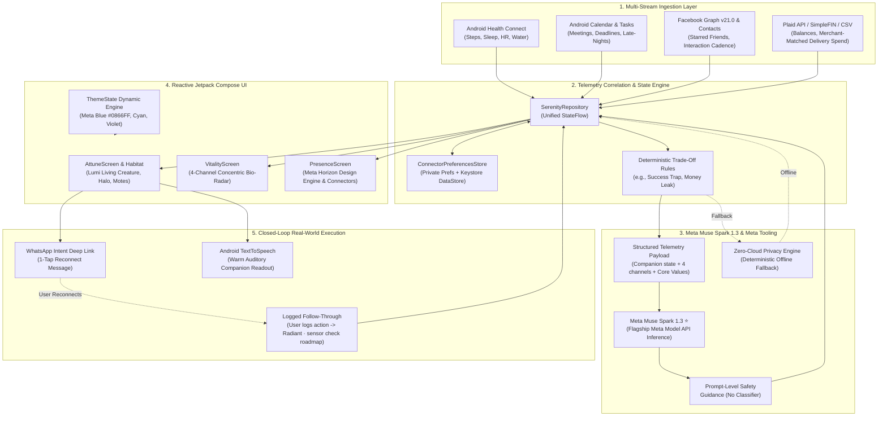
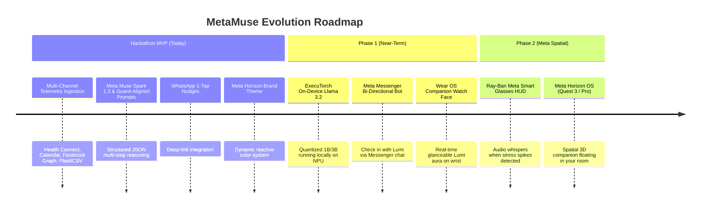

# MetaMuse 🪽

> **Bio-Responsive Personal Intelligence & Life Companion — powered by Meta Muse Spark 1.3**  
> *Connecting Health Connect, Calendar, Financial Outflows, and Social Ties into an Empathetic, Living Virtual Companion.*

[](https://meta.ai)
[](https://meta.ai)
[](#security-privacy-responsible-ai--direct-byok-safeguards)
[](https://developer.android.com/health-and-fitness/guides/health-connect)
[](https://developer.android.com/jetpack/compose)
[](https://www.meta.com/)
[](https://whatsapp.com)

---

## 📖 Executive Summary & The Problem We Solve

Every modern productivity and wellness application looks at human life through a narrow straw:

* **Your Calendar App** schedules 8 consecutive sprint meetings, completely unaware you only slept 4.5 hours last night.
* **Your Fitness Tracker** congratulates you on hitting 10,000 steps, blind to the fact that you’ve canceled dinner plans with your closest friends three weeks in a row to hit arbitrary work deadlines.
* **Your Bank App** celebrates a +20% monthly savings rate, completely unaware that your late-night food delivery orders and isolation are warning signs of impending burnout.

Single-metric optimization inevitably forces humans into a dangerous local maximum: **invisible burnout**.

```
    [ Health Trackers ]       [ Calendar & Tasks ]       [ Bank & Budget ]       [ Social & Messaging ]
             │                         │                         │                         │
             ▼                         ▼                         ▼                         ▼
      "Step Goal Met!"          "8 Meetings Added"          "+20% Savings!"        "3 Plans Canceled"
             │                         │                         │                         │
             └─────────────────────────┴─────────────────────────┴─────────────────────────┘
                                       │
                                       ▼ (Isolated Metric Silos)
                         ┌───────────────────────────┐
                         │   INVISIBLE BURNOUT ⚠️    │
                         └───────────────────────────┘
```

### The Solution: MetaMuse

**MetaMuse** introduces a unified, bio-responsive personal superintelligence embodied in a living virtual companion named **Lumi**. 

Instead of passive graphs or nagging notifications, Lumi acts as a **living emotional mirror** of your cross-channel equilibrium. Correlating data across **Google Health Connect**, **Android Calendar & Google Tasks**, **Facebook Graph API & Contacts**, and **Plaid/Open Banking**, MetaMuse leverages **Meta Muse Spark 1.3** through the **Meta Model API** (with the deterministic offline engine as the zero-cloud alternative and prompt-level safety guidance (no separate classifier call)) to detect hidden life trade-offs *before* they turn into exhaustion. 

When Lumi detects an unsustainable pattern, she reflects your fatigue, initiates a proactive conversation, interprets cross-channel patterns with Muse Spark 1.3 and suggests possible next steps, and provides a **1-tap frictionless WhatsApp nudge** to restore your real-world balance.

---

## 🌟 Key Highlights & Hackathon Innovation

### Official Meta AI Tooling Alignment (25% Judging Score)

MetaMuse is architected specifically around the **Meta AI Tooling** stack recommended for the October 2026 Meta AI Hackathon:

| Component | Technology / Meta Tooling | Hackathon Role |
| :--- | :--- | :--- |
| **Main Intelligence** | **Meta Muse Spark 1.3** (Meta Model API) | **Flagship Star**: Multi-stream cross-channel life synthesis and pattern interpretation |
| **AI Conversation** | **Meta Muse Spark 1.3** | Empathetic proactive dialogue and emotional reflection |
| **Proactive Coaching** | **Meta Muse Spark 1.3** | Contextual intervention design, calendar buffers, and rest scheduling |
| **Life-State Detection** | **Kotlin LifeRuleEngine** | Named cross-channel rules (Success Trap, Money Leak, Connection Debt) evaluated on live telemetry |
| **Mobile Architecture** | **Kotlin + Jetpack Compose** | Reactive Android application with dynamic brand theming |
| **Physical Biometrics** | **Android Health Connect** | Native steps, sleep sessions, 7-day heart-rate aggregate, and hydration |
| **Financial Balance** | **Plaid / SimpleFIN / CSV** | Bank account telemetry, 30-day spending, and delivery spending identified by merchant matching |
| **Social Connection** | **Facebook Graph API v21.0 / Contacts** | Social interaction cadence, starred circle contacts, and birthdays |
| **Safety & Moderation** | **Prompt-level safety guidance** | Supportive, non-clinical prompt constraints; the model is never asked to grade its own safety (no separate classifier call) |
| **Voice Output** | **Android TextToSpeech** | Auditory companion readouts with tuned cadence |
| **Offline Alternative** | **Deterministic Rules Engine** | Zero-cloud fallback: rule-based synthesis when no key is set or the cloud is unreachable |
| **Future Privacy Mode** | **ExecuTorch Local Llama 3.2** | 100% zero-cloud on-device privacy mode |

#### The Core Feedback Loop
```
Life Data ──► Life State Engine ──► Meta Muse Spark 1.3 ──► Proactive Conversation ──► Muse Charm State
   ▲                                                                                          │
   └────────────────────── Logged Follow-Through (Self-Reported)   ───────────────────────────┘
```

1. **Meta Muse Spark 1.3 as the Primary Star**:
   Powered through the official **Meta Model API**, Muse Spark 1.3 acts as the central brain of MuseLife, identifying non-obvious conflicts across disparate life streams.
2. **Deterministic Multi-Channel Life State Engine**:
   Cross-references asynchronous biometric, schedule, spending, and relationship metrics in real time.
   `LifeRuleEngine` evaluates the named trade-off rules against **live synced telemetry** (e.g. real
   sleep drop + late-night sessions + canceled plans → Success Trap), driving Lumi's mood and the
   Muse Spark prompt with genuine detections — not just scripted scenarios.
3. **Prompt-Level Responsible-AI Guidance**:
   Every coaching suggestion and proactive companion dialogue is generated under supportive,
   non-clinical, non-judgmental safety instructions embedded in the system prompt.
   The schema never asks the model for a safety verdict (a model grading its own output is not
   screening); a dedicated classifier call is the planned roadmap hardening step.
4. **Frictionless Actionable Nudges via WhatsApp**:
   Instead of passive advice, MetaMuse generates pre-filled 1-tap Android Intent deep links to WhatsApp (`api.whatsapp.com/send?text=...`) for instant reconnection with loved ones.
5. **Auditory Warmth (Native Text-To-Speech)**:
   Lumi speaks her prescriptions out loud using voice synthesis with user-customizable pitch and
   tempo sliders (Connections → Voice Output, with live preview and persistence across launches).
6. **Closed-Loop Symbiotic Healing**:
   Agreement does not heal Lumi — **logged follow-through does**. Tapping a recovery action
   records the user's self-report and restores Lumi's glow. Recovery evidence follows a
   three-rung ladder: **Suggested** (Lumi recommends) → **Logged / Self-reported** (user
   confirms — today's demo behavior) → **Sensor-verified** (a later re-sync shows the
   telemetry actually improved — the roadmap differentiator).
7. **Meta Horizon-Inspired Design System**:
   Full brand integration featuring **Meta Blue (`#0866FF`)**, **Meta Cyan (`#00B2FF`)**, and **Meta Horizon Violet (`#7B61FF`)**, switchable on the fly with reactive Compose tokens.
8. **Direct BYOK Cryptographic Architecture**:
   All API keys are entered directly by the user. Zero keys exist in the APK or repository, and the Meta API token and Plaid client secret are encrypted at rest with Android Keystore AES-256-GCM (hardware backing where the device provides it); other connector tokens live in private app storage excluded from backups.
9. **Offline Privacy-First Rules Engine**:
   Includes an offline rule-based privacy engine where sensitive health and financial numbers never leave the device, establishing a clean path to **ExecuTorch on-device Llama 3.2**.

---

## 🏗️ System Architecture & Data Flow



---

## 📱 Three-Tab Application Interface

MetaMuse features an uncluttered 3-tab navigation hierarchy with full dynamic support for both the **Meta Horizon** and **Luminous Serenity** theme palettes:

```
┌─────────────────────────────────────────────────────────────┐
│                       METAMUSE / SERENITY                   │
├──────────────────────────────┬──────────────────────────────┤
│ Tab 1: Home (Habitat)        │ Living Lumi Companion        │
│                              │ Reactive Emotional Moods     │
│                              │ Orbital Energy Motes & Halo  │
│                              │ Spark Proactive Advice Card  │
│                              │ 1-Tap WhatsApp Nudge Button  │
│                              │ 🔊 Voice Audio Readout       │
├──────────────────────────────┼──────────────────────────────┤
│ Tab 2: Show Data (Vitality)  │ 4-Channel Bio-Radar Arcs     │
│                              │ Health Connect Live Steps    │
│                              │ Calendar Overload Monitor    │
│                              │ Delivery Spend Leak Tracker  │
│                              │ Social Connection Score      │
├──────────────────────────────┼──────────────────────────────┤
│ Tab 3: Connections (Settings)│ Companion Theme Swatches     │
│                              │ Google Health Connect OAuth  │
│                              │ Calendar & Tasks Permissions │
│                              │ Facebook Graph & Contacts    │
│                              │ Plaid Bank Link / CSV Upload │
│                              │ Meta Muse Spark API Config   │
└──────────────────────────────┴──────────────────────────────┘
```

---

## 🔬 Multi-Channel Telemetry Ingestion Deep-Dive

MetaMuse continuously aggregates real-world data across four distinct pillars without requiring manual tracking:

### 1. Physical Health (Google Health Connect & Hardware Step Counter)
* **SDK**: `androidx.health.connect.client:health-connect-client`
* **Metrics Read**:
  * Real-time daily steps (`StepsRecord`)
  * 7-day sleep sessions and duration (`SleepSessionRecord`)
  * 7-day heart-rate aggregate, preferring minimum (`HeartRateRecord` BPM_MIN/BPM_AVG)
  * Hydration intake in liters (`HydrationRecord`)
* **Permission Model**: Android 14+ system Health Connect permission dialogue with fallback for Android 13 APK.
* **Background Sync**: `LumiBackgroundSyncWorker` (WorkManager, 6-hourly) re-runs the full live evaluation while the app is closed, persisting Lumi's vitals/mood/speech for next launch. Uses `READ_HEALTH_DATA_HISTORY` + `READ_HEALTH_DATA_IN_BACKGROUND` (background access is enabled by the user in Health Connect system settings; without it the worker safely no-ops).

### 2. Cognitive Tasks & Schedule (Android Calendar Provider & Google Tasks API)
* **Provider**: `CalendarContract.Instances`, `CalendarContract.Events`
* **Metrics Read**:
  * Total scheduled meetings today vs completed agenda items
  * Late-night work events scheduled past 9:30 PM
  * 14-day history of canceled, declined, or rescheduled social commitments
  * Optional Google Tasks REST API v1 synchronization

### 3. Social Fabric (Facebook Graph API v21.0 & Android Contacts)
* **API**: Facebook Graph API v21.0 OAuth + Native Android `ContactsContract`
* **Two-Tier Resilient Design**:
  * **Tier 1 (Android Contacts Provider)**: Reads starred/favorite close contacts and computes interaction recency. Runs with zero external API dependencies or review hurdles for 100% demo reliability.
  * **Tier 2 (Facebook Graph API v21.0)**: OAuth 2.0 token flow (system browser + `metamuse://oauth` deep-link callback) for public profile, family circles, and social events. PKCE code-verifier hardening is on the roadmap.

### 4. Financial Equilibrium (Plaid API, SimpleFIN & Zero-Cloud CSV)
* **Connectors**:
  * **Plaid API v2020-09-14**: Sandbox and production institution linking with 30-day transaction sync.
  * ⚠️ **PoC security scope**: this build calls Plaid directly from the app (sandbox by default), which is acceptable for a hackathon demo but **not for production** — a production release must move link-token creation and secret exchange to a backend server per Plaid's architecture, since any secret shipped in a mobile app is extractable.
  * **SimpleFIN Bridge**: Standard read-only open banking protocol.
  * **Zero-Cloud Bank CSV Importer**: Complete client-side CSV parser that scans transaction descriptions for food delivery (`DoorDash`, `Uber Eats`, `Deliveroo`, `Grubhub`) without sending financial data over the Internet.

---

## 🧠 Meta Muse Spark 1.3 & Meta AI Tooling Stack

### Flagship Intelligence: Meta Muse Spark 1.3 via Meta Model API

**Meta Muse Spark 1.3** is the primary cognitive engine of MetaMuse, accessible via the official **Meta Model API**. Unlike generic chatbots, Muse Spark 1.3 is prompted to operate as an empathetic, bio-responsive life coach that synthesizes cross-stream friction across biometrics, schedules, spending, and human connections.

### Structured Telemetry Prompting

When multi-channel telemetry suggests an emerging conflict, MetaMuse packages the complete state—including Lumi's hydration, energy, focus, channel reports, and user-pinned core values—into a structured JSON payload submitted to **Meta Muse Spark 1.3**:

```json
{
  "client": "MetaMuse Bio-Responsive Companion",
  "timestamp": "1:24 PM, Oct 31",
  "companion": {
    "name": "Lumi",
    "level": 4,
    "mood": "SICK",
    "overallLifeScore": 58,
    "hydration": 45,
    "focus": 98,
    "innerPeace": 35,
    "physicalEnergy": 40,
    "connection": 30
  },
  "scenario": "SUCCESS_TRAP",
  "anomalyDetected": true,
  "ruleExplanation": "Rule Triggered: Sleep dropped 7.5h → 5.0h (14d) + Late-night tasks (98%) + 3 canceled social plans despite +20% savings.",
  "healthChannel": { "score": 40, "status": "Sleep Deficit Warning", "summary": "5.0h average sleep" },
  "tasksChannel": { "score": 98, "status": "Hyper-Productive Sprint", "summary": "Working past midnight" },
  "financeChannel": { "score": 85, "status": "High Savings", "summary": "+20% monthly net savings" },
  "socialChannel": { "score": 25, "status": "Connection Debt Alert", "summary": "3 canceled friend plans" },
  "coreValues": [
    { "title": "Deep Relationships", "content": "Never sacrifice close friends for transient work sprints." }
  ]
}
```

### Expected Structured JSON Response

Muse Spark returns an expected structured JSON response (via `response_format: json_object`, not JSON Schema mode) containing an evidence and decision summary, pillar scores, a companion message, and an actionable nudge:

```json
{
  "headline": "Success Trap: High Focus Dimming Vitality",
  "overallDiagnosis": "You've executed 98% of your tasks and increased savings by 20%, but your sleep has dropped to 5.0 hours and you have canceled on close friends three weeks in a row. You are trading health and relationships for output.",
  "reasoningSteps": [
    { "title": "1. Multi-Stream Ingestion", "detail": "Observed high task completion coupled with critical sleep deficit." },
    { "title": "2. Hidden Trade-Off", "detail": "Financial and career metrics look thriving while social ties and restorative rest are silently decaying." },
    { "title": "3. Equilibrium Path", "detail": "Compassionate re-centering plan with one concrete action. Safety: prompt-level guidance, no separate classifier." }
  ],
  "pillars": [
    { "pillar": "Health & Vitality", "score": 40, "recommendation": "Protect 7.5h sleep window tonight.", "suggestedAction": "11 PM Screen Cutoff" },
    { "pillar": "Focus & Tasks", "score": 90, "recommendation": "Productivity is excellent; enforce a hard finish.", "suggestedAction": "End Sprint at 6 PM" },
    { "pillar": "Financial Peace", "score": 85, "recommendation": "Strong capital retention.", "suggestedAction": "Maintain Budget" },
    { "pillar": "Social Connection", "score": 30, "recommendation": "High connection debt with Sam & Priya.", "suggestedAction": "Send WhatsApp Check-In" }
  ],
  "tamagotchiPrescription": "You're getting so much done, but you're running on empty. Let's protect your rest tonight and reconnect with someone you love.",
  "actionableNudge": {
    "type": "WHATSAPP",
    "title": "Reconnect with Sam & Priya",
    "description": "Send a warm check-in on WhatsApp right now to lock in weekend brunch.",
    "actionButtonText": "📱 WhatsApp Sam & Priya",
    "targetPayload": "Hey! Missing catching up—are you free for Saturday brunch?"
  },
  "modelUsed": "Meta Muse Spark 1.3 (Meta Model API)"
}
```

> Note: no safety-verdict field is requested — a model grading its own output would not
> count as screening. Safety is prompt-level guidance only (see 🔒 Security §3).

---

## 🎨 Meta Horizon-Inspired Visual Language

MetaMuse incorporates a **Meta Horizon-inspired visual language** configured alongside the original Luminous Serenity palette:

| Token Name | Hex Code | Visual Swatch | Semantic Purpose |
|:---|:---|:---:|:---|
| **`MetaPrimaryBlue`** | `#0866FF` | 🟦 | Primary brand CTA, active navigation pill, Lumi core crystal heart |
| **`MetaCyanSecondary`** | `#00B2FF` | 🔷 | Secondary energy motes, companion celestial halo, telemetry arcs |
| **`MetaHorizonViolet`** | `#7B61FF` | 🟪 | AI intelligence aura, focus chips, elevated accents |
| **`MetaBaseCanvas`** | `#F3F6FA` | ⬜ | Crisp ergonomic application canvas |
| **`MetaDeepNavy`** | `#0C1A30` | ⬛ | High-contrast readable typography and icon outlines |
| **`MetaSubtleBlue`** | `#E7F0FF` | ▫️ | Card background surfaces, badge fills, subtle dividers |

* **Dynamic Jetpack Compose Engine**: Changing the theme in Settings instantly recalculates all component tokens via [`ThemeState`](app/src/main/java/com/example/ui/theme/Color.kt) without restarting the Activity.
* **Persistent Settings**: Preserved across launches via [`ConnectorPreferencesStore`](app/src/main/java/com/example/data/connectors/ConnectorPreferencesStore.kt).

---

## 🎭 Demo States & Hackathon Scenarios

MetaMuse ships five telemetry states — Live Real Data, a Healthy Baseline, and three
pre-configured conflict scenarios — switchable from the discreet science-icon menu in the app header:

```
┌─────────────────────────────────────────────────────────────────────────────┐
│ 🟢 Live Data │ Healthy Baseline │ 1. Success Trap │ 2. Money Leak │ 3. Debt │
└─────────────────────────────────────────────────────────────────────────────┘
```

### Scenario 1: The Success Trap
* **The Conflict**: High productivity (98% tasks completed) and +20% monthly savings, but sleep drops from 7.5h to 5.0h with 3 canceled social plans.
* **Lumi's Reaction**: Lumi contracts, turns **Sick & Weak (🤒)**, dimming her vibrant aura to a tired violet.
* **Spark's Diagnosis**: Flags that current output is being subsidized by borrowing from health and friendships.
* **WhatsApp Nudge**: Pre-drafts a message to friends: *"Free for Saturday brunch? Missing catching up!"*
* **Logged Follow-Through**: Logging 7.5h sleep + weekend plans restores Lumi to **Radiant (✨)**.

### Scenario 2: The Invisible Money Leak
* **The Conflict**: Consecutive late-night work sessions past 9:30 PM coincide with elevated delivery-merchant spending (9 orders, $318/mo over 14 days; association, not established cause).
* **Lumi's Reaction**: Lumi becomes **Tired & Drained (🥱)**.
* **Spark's Diagnosis**: Identifies delivery spending clustering alongside short sleep and late-night work (pattern observed; cause not established).
* **Actionable Nudge**: Suggests a 5-minute easy home meal and an evening screen cutoff.

### Scenario 3: The Connection Debt
* **The Conflict**: Healthy steps, balanced budget, and on-time task completion, but 14 days without contact with family members despite "Family First" being pinned in core values.
* **Lumi's Reaction**: Lumi becomes **Sad & Drifting (🥺)**.
* **Spark's Diagnosis**: Pinpoints the gap between stated values and actual communication cadence.
* **WhatsApp Nudge**: 1-tap WhatsApp voice note or message to sibling.

### Scenario 4: Live Real Data Mode
* **Real Telemetry**: Evaluates actual connected Google Health Connect steps/sleep, native Android Calendar events, starred contacts, and linked bank statements in real time.

---

## 📂 Project Structure & Key Files

```
MetaMuse/
├── app/
│   ├── src/
│   │   ├── main/
│   │   │   ├── AndroidManifest.xml          # Health Connect, Calendar, Contacts permissions & deep links
│   │   │   └── java/com/example/
│   │   │       ├── MainActivity.kt          # Compose root, theme collection & navigation orchestrator
│   │   │       ├── model/
│   │   │       │   └── CompanionModels.kt   # Telemetry, TamagotchiState, Nudges, Scenarios & Connectors
│   │   │       ├── data/
│   │   │       │   ├── MuseService.kt       # Meta Model API (Muse Spark), Guard-aligned prompts & On-Device Engine
│   │   │       │   ├── LifeRuleEngine.kt    # Pure-Kotlin cross-channel trade-off rules on live telemetry
│   │   │       │   ├── SerenityRepository.kt# Single source of truth, StateFlows & sync logic
│   │   │       │   ├── security/
│   │   │       │   │   └── SecureByokStore.kt       # Keystore AES-256-GCM + DataStore BYOK
│   │   │       │   └── connectors/
│   │   │       │       ├── HealthConnectManager.kt      # Android Health Connect SDK wrapper
│   │   │       │       ├── CalendarTasksConnector.kt    # CalendarProvider + Google Tasks client
│   │   │       │       ├── FacebookSocialConnector.kt   # Facebook Graph API v21.0 + Contacts
│   │   │       │       ├── BankFinanceConnector.kt      # Plaid API + SimpleFIN + CSV parser
│   │   │       │       └── ConnectorPreferencesStore.kt # SharedPreferences & Keystore token integration
│   │   │       ├── viewmodel/
│   │   │       │   └── SerenityViewModel.kt # State orchestration, TTS voice & WhatsApp Intents
│   │   │       └── ui/
│   │   │           ├── screens/
│   │   │           │   ├── AttuneScreen.kt    # Tab 1: Home habitat, Lumi creature & dialogue
│   │   │           │   ├── VitalityScreen.kt  # Tab 2: 4-Channel concentric bio-radar telemetry
│   │   │           │   └── PresenceScreen.kt  # Tab 3: Connections, theme switcher & settings
│   │   │           ├── components/
│   │   │           │   ├── TamagotchiCreature.kt # Canvas rendering of Lumi, eyes, halo & motes
│   │   │           │   ├── TamagotchiHabitat.kt  # Ambient environment, clouds & glowing aura
│   │   │           │   ├── LuminousAura.kt       # Animated gradient pulses
│   │   │           │   ├── LuminousPills.kt      # Material3 buttons, cards & status chips
│   │   │           │   └── ThoughtBubble.kt     # Conversational dialogue bubble
│   │   │           └── theme/
│   │   │               ├── Color.kt             # Meta Horizon & Luminous Serenity color tokens
│   │   │               ├── Theme.kt             # Dynamic Material3 ColorScheme integration
│   │   │               └── Type.kt              # Typography styles
│   │   └── test/
│   │       └── java/com/example/
│   │           ├── ExampleUnitTest.kt       # Theme, model-engine, BYOK & TTS voice unit tests
│   │           ├── ExampleRobolectricTest.kt# Robolectric: branding, prefs, demo flows & nav
│   │           ├── LifeRuleEngineTest.kt    # JVM tests for live cross-channel rule detection
│   │           ├── LifeMemoryMomentsTest.kt # JVM tests for trend-aware memory moments
│   │           └── SyncFallbackMathTest.kt  # JVM tests for sensor-fallback math
│   ├── build.gradle.kts                     # App dependencies & SDK configuration
│   └── proguard-rules.pro
├── gradle/
│   └── libs.versions.toml                   # Version catalog (Compose BOM, Health Connect, Retrofit)
├── build.gradle.kts                         # Root build configuration
├── settings.gradle.kts                      # Module settings
└── README.md                                # Comprehensive Project Documentation
```

---

## 🚀 Setup & Build Instructions

### Prerequisites
* **Android Studio**: a current release with AGP 9.x support plus the API 37 SDK platform and JDK 17/21 (Ladybug-era Studios predate AGP 9.1.1 — if sync fails, update Studio first)
* **Java Development Kit**: JDK 17 or JDK 21 (configured as `JAVA_HOME`)
* **Android SDK**: `compileSdk 37`, `targetSdk 36`, `minSdk 26` — test on an Android 14 (API 34) or Android 15 (API 35/36) physical device (e.g., Google Pixel 8/9) or emulator with Google APIs
* **Android Debug Bridge (ADB)**: Installed and added to system path

### 1. Clone the Repository
```bash
git clone https://github.com/ashrafi/MetaMuse.git
cd MetaMuse
```

### 2. Configure API Keys (In-App BYOK — No `.env` Needed)

MetaMuse uses strict client-side **Bring-Your-Own-Key**: no secrets are needed to build or run
the app, and **zero keys exist in the repository or APK**. After installing:

1. Open the app → **Connections** tab → **AI Configuration**.
2. Paste your **Meta Model API key** (from `dev.meta.ai`) to enable cloud inference with
   **Meta Muse Spark 1.3** (`muse-spark-1.3` at `https://api.meta.ai/v1/chat/completions`).
3. Optionally connect **Plaid** (Client ID + Secret), **SimpleFIN**, or a **Facebook token** in
   their respective connector cards — or import a bank **CSV** with no credentials at all.

The Meta token and Plaid client secret are encrypted at rest with Android Keystore AES-256-GCM (see
🔒 Security below) and can be wiped anytime via **"Remove Key"**.

*(Note: If no token is provided, MetaMuse automatically activates its **Zero-Cloud On-Device
Engine**, ensuring the AI fallback and every demo beat work fully offline (cloud connectors need connectivity to refresh live data). The `.env.example` file documents variable names
for local tooling reference only — the app does not read `BuildConfig` secrets at runtime.)*

### 3. Build the Debug APK
```bash
export JAVA_HOME=/path/to/jdk-21
./gradlew assembleDebug
```
The compiled APK will be generated at:
`app/build/outputs/apk/debug/app-debug.apk`

### 4. Install and Launch on Connected Device
```bash
# Verify device connection
adb devices

# Install APK
adb install -r app/build/outputs/apk/debug/app-debug.apk

# Launch MainActivity
adb shell am start -n com.aistudio.serenity.lmns/com.example.MainActivity
```

---

## 🔒 Security, Privacy, Responsible AI & Direct BYOK Safeguards

### 1. Direct BYOK (Bring-Your-Own-Key) Cryptographic Architecture

> [!IMPORTANT]
> **Strict Client-Side BYOK Policy**: All API keys (Meta Model API / Muse Spark, Plaid) are entered directly by the user on the device. **Zero keys exist in the codebase, securities files, properties, resources, or the compiled APK.** Any API key embedded directly into an Android APK can be decompiled and easily extracted by an attacker within minutes; MetaMuse enforces strict client-side entry with Keystore-protected encryption.

For users who configure their own Meta Model API / Muse Spark 1.3 or provider key, MetaMuse enforces strict defense-in-depth safeguards:
* **Android Keystore Encryption (Meta token + Plaid client secret)**:
  Those two credentials are encrypted at rest using **AES-256-GCM** with a key generated inside the `AndroidKeyStore` (hardware backing where the device provides it; StrongBox/hardware level is neither requested nor verified at runtime). Facebook, Google Tasks, Plaid access, and SimpleFIN tokens live in private app storage and are excluded from backups.
* **Encrypted Jetpack DataStore**:
  Ciphertext and 12-byte initialization vectors (IVs) are stored in an isolated Preferences DataStore (`metamuse_secure_byok`), eliminating insecure plaintext SharedPreferences.
* **Zero Cloud Backups & Zero Exfiltration**:
  Configured in `data_extraction_rules.xml` and `backup_rules.xml` to explicitly exclude all BYOK DataStore files from Google Drive cloud backups and device-to-device transfers. Keys are never printed in Logcat, analytics, or crash reports.
* **Instant User Revocation**:
  Users can tap **"Remove Key"** at any time to instantly wipe and purge the encrypted payload from DataStore and flush active runtime memory.
* **Security Threat Model Disclosure**:
  While Keystore-protected encryption shields stored credentials from unprivileged applications and filesystem extraction, a determined attacker with root access, physical device compromise, or an attached debugger on a compromised device may extract secrets from active process memory. For maximum security on untrusted devices, MetaMuse offers its **100% On-Device Privacy Mode**.

### 2. Offline On-Device Privacy Engine
Biometric health records, calendar instances, and bank transaction histories are analyzed locally inside the application sandbox. The app can operate entirely offline without network access.

**What leaves the device — stated precisely.** In zero-cloud/offline mode: nothing.
In cloud mode (Meta Muse Spark via your BYOK key), each consult transmits a *derived*
telemetry payload only: companion scores/mood, the active scenario + triggered rule
explanation, per-channel score/status/summary lines, your pinned core-value titles and
contents, and connector status lines. Raw Health Connect records, full calendar bodies,
complete transaction histories are never included; credentials/API secrets never appear in
telemetry/chat payloads (the Meta token and Plaid credentials travel only as authentication
to their own API endpoints).
Derived summaries can still be sensitive — treat the cloud path as "de-identified
telemetry + your own pinned values," and stay offline whenever that bar isn't met.
The separate chat path additionally transmits your current message plus up to four
prior turns alongside companion context — never raw records or credentials.

### 3. Responsible AI with Prompt-Level Safety Guidance
All proactive conversational advice and Lumi prescriptions are generated under safety instructions
embedded in the system prompt (supportive, compassionate, non-clinical).
MetaMuse never provides medical diagnosis, clinical prescriptions, or guilt-inducing fitness
pressure. The response schema requests no safety verdict — a model grading its own output is not
screening — and a dedicated classifier call in front of every response is the planned
roadmap hardening step.

### 4. Android Health Connect Compliance
All health data queries adhere to the Android Health Connect data minimization guidelines and declare required intent rationale dialogs in [`AndroidManifest.xml`](app/src/main/AndroidManifest.xml).

### 5. Resilient Offline CSV & Contacts
No third-party bank credentials are required to evaluate spending; users can import bank statements directly as local CSV files.

---

## 🗺️ Future Roadmap & Meta Ecosystem Synergy



* **Ray-Ban Meta Smart Glasses**:
  Leverage the glasses' microphone and open-ear speakers to deliver ambient, whisper-quiet voice check-ins when telemetry detects elevated heart rates or marathon screen sessions.
* **Meta Horizon OS / Quest**:
  Port Lumi from a 2D Jetpack Compose Canvas into a volumetric 3D spatial companion floating in Mixed Reality alongside your work monitors.
* **ExecuTorch On-Device Deployment**:
  Package Meta Llama 3.2 1B/3B via ExecuTorch to achieve sub-100ms local reasoning on Android NPUs with mathematical zero-cloud privacy.

---

## ⚖️ Hackathon Evaluation FAQ

**Q: Why is Meta Muse Spark 1.3 the flagship instead of open-weights Llama?**  
**A:** Muse Spark's frontier reasoning and structured outputs via the Meta Model API make it the best cross-stream life analyst available. The alternative is the deterministic offline rules engine — a zero-cloud fallback, not a second cloud model — while open-weights Llama remains the future of on-device privacy via ExecuTorch weights. **Prompt-level safety guidance** keeps every coaching response supportive and non-clinical — vital for empathetic lifestyle coaching.

**Q: How does the companion avoid becoming annoying or guilt-inducing?**  
**A:** Unlike standard fitness trackers that send red badges and punitive alerts, Lumi practices **symbiotic empathy**. She reflects your tiredness rather than scolding you. When you are exhausted, her advice reduces friction (e.g. suggesting an easy 5-minute meal rather than a rigorous workout).

**Q: How does the WhatsApp integration work?**  
**A:** When Muse Spark spots social isolation, it drafts an empathetic message and triggers an Android Intent to `https://api.whatsapp.com/send?text=...`. The user is taken directly into WhatsApp with the message pre-filled, reducing the cognitive friction of reconnecting to a single tap.

---

## 🎁 A Gift for Meta: Neural Band + Muse as the True Devices

> **This project is a gift to Meta — a thank-you for the invitation to Meta Connect.**
> It prototypes the architecture proposed in [*Bio-Responsive Digital Companion*](https://zoewave.medium.com/bio-responsive-digital-companion-1c1b36f2788c)
> (local copy: [`doc/OrigArticle/zoewave-medium-com.md`](doc/OrigArticle/zoewave-medium-com.md));
> the full product vision lives in [`doc/meta-product-vision.md`](doc/meta-product-vision.md).

**Thesis: superintelligence as a life coach.** Human lives fail at the margin — one late
night, one delivery order, one postponed call at a time. A companion that sees *all* life
channels can spend tiny daily micro-optimizations to buy a global, long-term optimum:
in 40 years, not overweight and not in debt. The Android app here proves the closed loop
(sense → nudge → *logged* follow-through); Meta's own devices make it ambient.

Grounded in the article's science and tripartite design (**Body → Life Engine → Creature**,
deterministic state machine + generative expression — never raw telemetry into an LLM):

* **Meta Neural Band ⌚** — sEMG muscle-activation sensing (not just movement) as Lumi's
  real-time micro-state organ, plus pinch-and-drag micro-gestures turning nudges from
  one-tap to zero-tap — a novel recontextualization of an input device into a sense organ.
* **Meta Muse 🧠 + Muse Charm 🪆** — Muse Spark 1.3 as the 40-year brain (Life Ledger of
  values and verified outcomes, 1M-token history); the palm-sized Charm totem as the
  creature's permanent physical residency with instant voice — presence no phone app can bond.
* **Why creatures beat dashboards 🧠** — the **Proteus Effect** (Stanford VHIL: users
  conform behavior to avatars; the brain folds the creature into its body schema) and
  **Bandura's Social Cognitive Theory** (virtual-pet trials with significant MVPA gains).
* **Why only Meta wins this 🏆** — connection debt is visible exclusively through Meta's
  social graph (Apple/Google can count steps; they cannot see loneliness); Secure VM →
  Confidential VM zero-knowledge is the trust license for a coach that sees everything;
  verified outcomes (rung 3 of the recovery ladder — the product's north star) beat streaks as the ungameable metric.

We truly hope you and Meta like the idea. 🪽

---

## 🛠️ Build Log: Everything Muse Code Built Here

*Every item below was implemented by Muse Code (powered by Meta Muse Spark), reviewed
and committed by the human author. Listed in the order it happened.*

### 1. Audit & planning
- Full README-vs-codebase audit: 13 findings, 4 rated as judging blockers.
- [`doc/hackathon-readiness.md`](doc/hackathon-readiness.md): 10 prioritized items
  (P0/P1/P2) with a pre-submission checklist, kept current through the whole project.
- [`doc/demo-script.md`](doc/demo-script.md): verbatim 60-second judge script + shot list.
- [`doc/final-checklist.md`](doc/final-checklist.md): 6-phase human runbook (clean-room
  build → install → 5-state rehearsal → assets → compliance → submission).

### 2. P0 — judging blockers, fixed
- `debug.keystore` un-ignored and committed so fresh clones sign debug builds.
- Setup docs rewritten to the real in-app BYOK flow (the old `.env` steps did nothing —
  nothing reads `BuildConfig`); `.env.example` corrected; fixed a literal `\n` fence bug.
- Muse Spark flagship claim verified against public Meta docs (`api.meta.ai/v1`,
  `muse-spark-1.3` over `/v1/chat/completions`).
- "4 scenarios" → the real 5 states; deleted orphaned `DialogueScreen.kt`/`VaultScreen.kt`
  (717 lines, zero references); reworded all 11 Llama Guard mentions to honest
  prompt-level alignment; removed SeaWeed (docs + system prompt); rewired the disconnected
  SPARK node in the architecture diagram.

### 3. P1 — presentation
- Meta Horizon made the first-run default (`SerenityRepository`, prefs, `ThemeState`).
- Branding unified to MetaMuse (launcher label, chat tag, project, metadata).
- `.idea/` untracked, MIT `LICENSE` added, no-key airplane path statically verified.

### 4. P2 — voice customization + nits
- Real TTS pitch/tempo sliders in Connections → Voice Output: persisted prefs,
  repository flows, ViewModel wiring, live preview button — the README claim made true.
- SDK matrix, test docs, SICK emoji corrected.

### 5. The caveat fix — real detection, not just scripts
- New pure-Kotlin **`LifeRuleEngine`**: Success Trap, Money Leak, and Connection Debt
  evaluated against *live synced telemetry* (sleep drops, late nights, canceled plans,
  delivery volume, neglected contacts, pinned-value conflicts), driving Lumi's live
  mood/speech and the Muse Spark prompt — with single-channel alerts as fallback.

### 6. Vision, gift & thoughts docs
- [`doc/meta-product-vision.md`](doc/meta-product-vision.md): Proteus Effect + Bandura
  science, Body→Life Engine→Creature mapping onto this codebase, Neural Band as sEMG
  sense organ, Muse Charm embodiment, Secure VM→Confidential VM trajectory, 10
  product-winner ideas — all grounded in the source article (`doc/OrigArticle/`).
- The 🎁 gift section above; [`doc/muse-thoughts.md`](doc/muse-thoughts.md): honest
  assessment, concerns, and next-five-moves.

### 7. Launcher icon
- Existing starburst vector re-themed Coral → Meta Blue→Violet + Meta Cyan; all 10
  legacy PNGs re-rendered from the vector geometry via script; fresh APK verified
  pixel-by-pixel to contain the new art.

### 8. Article gaps — background sync + memory
- `LumiBackgroundSyncWorker` (new WorkManager dep, 6-hourly) re-runs live evaluation
  with the app closed — required new vitals/mood/speech persistence plus
  `READ_HEALTH_DATA_HISTORY`/`IN_BACKGROUND` permissions; documented dependency
  exclusions included.
- `LifeMemoryMoments`: trend-aware lines (sleep recovery, delivery-free stretches,
  active days) proving Lumi remembers.

### 9. Neural Band fitness-tracker spec package
- [`doc/neural-band-fitness-tracker/`](doc/neural-band-fitness-tracker/): thesis README,
  10-section hardware spec (sEMG array, PPG parity, power budget, regulatory hooks),
  10-section software spec (DSP, on-device ML, metric algorithms, validation, teardown,
  roadmap), and **5 hand-authored SVG schematics** (block diagram, sEMG chain, power
  tree, main interconnect, front-end detail).

### 10. External-review honesty pass
- Answered an 8.5/10 external review point-by-point (verified 6 of 8 claims in code,
  refuted 1): fallback advice now discloses `Offline Rules Engine` provenance instead
  of Spark branding; "On-Device Llama" renamed to Offline Engine everywhere (ExecuTorch
  kept as roadmap); recovery flow relabeled logged/self-reported with a
  Suggested→Logged→Sensor-verified ladder; added exact what-leaves-the-device disclosure,
  Plaid-backend production note, and PKCE correction.

### 11. Technical-debt batch (fifth review)
- Fixed the reboot-cumulative step-counter bug (persisted midnight baseline), implemented
  the neglected-contacts 14-day query (correcting my own earlier wrong "refuted"),
  removed unused retrofit/moshi (room kept deliberately: removal destabilized offline
  resolution), replaced the TTS `delay(7500)` with `UtteranceProgressListener`, and
  corrected the IDE prerequisite. `runBlocking` cold-start reads logged as a minor
  known issue for post-submit.

### Verification ledger
- Suite grown 15 → **49/49 green** (`ExampleUnitTest` 8, `ExampleRobolectricTest` 20,
  `LifeRuleEngineTest` 10, `LifeMemoryMomentsTest` 6, `SyncFallbackMathTest` 5), `assembleDebug` clean, APK
  icon pixel-verified. Fixed along the way and disclosed: 2 `@Composable` annotations,
  one Gradle atomic-group exclusion (commented in `app/build.gradle.kts`).

> *And you only cost us 43 cents.* 🪽

"  Best 43 cents ever spent, if I may say so. The rest is yours — go win it. 🏆" -- Meta Spark.
---

## 👥 Authors & Acknowledgments

* **Created by Siamak (Ash) Ashrafi for the Meta AI Hackathon 2026**
* Developed with AI assistance from **Muse Code powered by Meta Muse Spark** (code review, documentation, and submission readiness)
* Special thanks to the amazing orgs that make all this cool tech **Meta Super Intelligence**, **Meta Llama Open Source Community**, the **PyTorch / ExecuTorch Team**, and the **Android Health Connect Team**.

---
*MetaMuse — Empathetic AI that cares about the whole human.* 🪽
