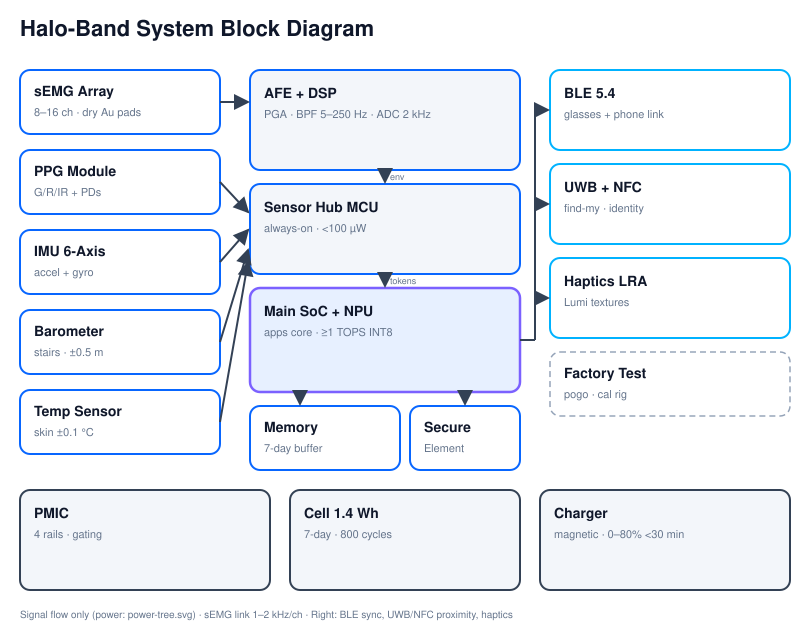
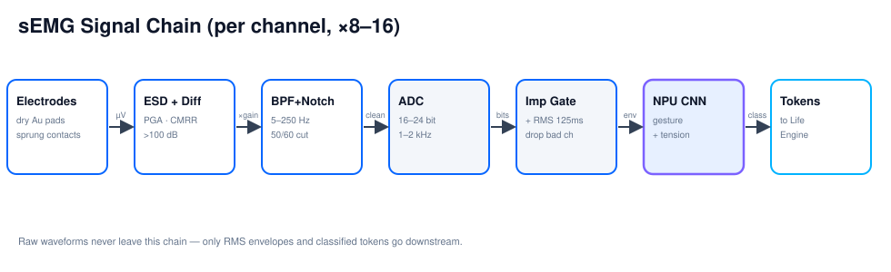
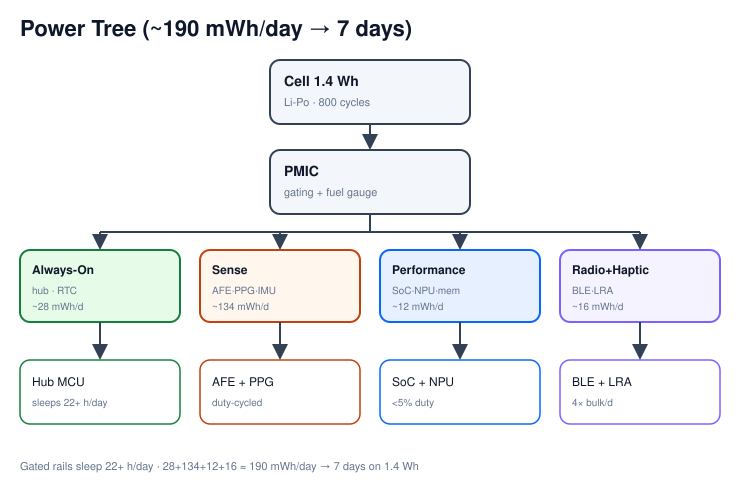

# Hardware Diagrams 📐

Hand-authored vector schematics (edit the `.svg` sources directly — no export step).
They render inline on GitHub and in most Markdown viewers.

## System Block Diagram

Full signal architecture: sensors → AFE → sensor hub → SoC+NPU → radios/haptics,
plus the power subsystem. See [`spec.md`](spec.md) §2–§6 for the numbers behind
every block.

## sEMG Signal Chain

Per-channel path from dry electrode to classified token. The key guarantee, drawn as
the boundary it is: raw waveforms never leave this chain.

## Power Tree

Cell → PMIC → four gated rails → loads, annotated with the daily budgets that sum to
the 7-day battery target.
